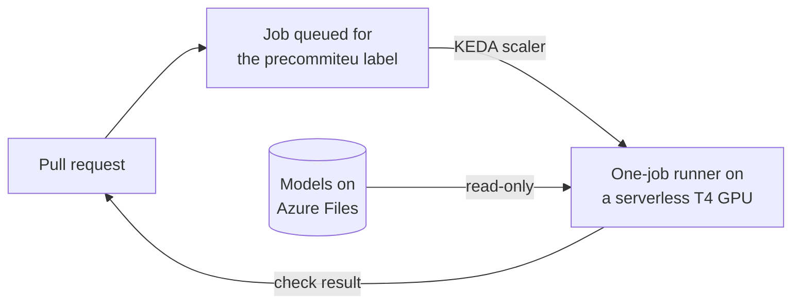

<p align="center">
  <picture>
    <source media="(prefers-color-scheme: dark)" srcset="https://raw.githubusercontent.com/AlexandruGirlea/precommiteu/main/docs/assets/img/bat-hero-dark.png">
    
  </picture>
</p>

<h1 align="center">precommitEU ops</h1>

<p align="center">
  <strong>Bring GenAI compliance scanning into your enterprise CI.<br>
  Run the models in your Azure subscription. No external LLM service.</strong>
</p>

<p align="center">
  Free, Apache-2.0 infrastructure for precommitEU: Terraform or Pulumi,
  serverless T4 GPUs, and GitHub Actions runners that scale to zero.
</p>

<p align="center">
  <a href="https://github.com/AlexandruGirlea/precommiteu-ops/releases/latest"></a>
  <a href="https://github.com/AlexandruGirlea/precommiteu-ops/actions/workflows/ci.yml"></a>
  <a href="LICENSE"></a>
</p>

<p align="center">
  <a href="https://github.com/AlexandruGirlea/precommiteu"><strong>Explore the scanner</strong></a>
  &nbsp;&middot;&nbsp;
  <a href="#terraform">Terraform</a>
  &nbsp;&middot;&nbsp;
  <a href="#pulumi">Pulumi</a>
  &nbsp;&middot;&nbsp;
  <a href="#cost-and-speed">Costs and speed</a>
  &nbsp;&middot;&nbsp;
  <a href="https://huggingface.co/AlexandruGirlea/precommiteu-models">Model bundle</a>
  &nbsp;&middot;&nbsp;
  <a href="https://precommit.eu">precommit.eu</a>
</p>

**[precommitEU](https://github.com/AlexandruGirlea/precommiteu) is the scanner;
this repository deploys it for your team.** It uses generative AI to review
source code against eight EU regulations and reports findings with quoted
code evidence. The scanner, model weights and deployment code are all
available under Apache-2.0.

**The scanner supports fully air-gapped operation after installation.**
precommitEU publishes the model weights alongside the scanner, so every
inference call stays inside your infrastructure. You do not need to connect
an external LLM service or supply an LLM API key.

This Azure deployment runs those models locally on the runner and connects
to GitHub for CI. It is not a fully air-gapped deployment. For disconnected
networks, use the scanner's
[air-gapped installation guide](https://alexandrugirlea.github.io/precommiteu/install.html#air-gapped-and-offline-installation).

There is no software subscription or per-scan licence fee; you pay for your
Azure resources. Each runner handles one job and exits, so GPU compute
scales to zero between scans while the model share remains available.

**[Deploy with Terraform](#terraform)** · **[Deploy with Pulumi](#pulumi)** ·
[See the scanner's evaluation results](https://github.com/AlexandruGirlea/precommiteu#detection-quality)



## Local inference and network access

precommitEU brings its own models and runs them on a GPU inside your Azure
subscription. All inference runs locally on the runner, using the downloaded
model bundle. Scanning requires no LLM API key.

The deployment is not network-isolated: runners need GitHub for registration,
job polling, checkout and report uploads, and GHCR for container images.
The model download job also needs Hugging Face and its download endpoints.
Azure manages the resources and storage inside your subscription. No source
code is sent to Hugging Face or an external LLM API. For a disconnected
scanner installation, see the
[offline guide](https://alexandrugirlea.github.io/precommiteu/install.html#air-gapped-and-offline-installation).

## Choose when to upgrade

Each precommitEU ops release pins the scanner, the runner image tag and the
model revision. You control which version runs in your environment and when
to upgrade. These pins identify the software and weights; results can vary
across hardware or runtime changes.

## What it creates

In an existing resource group:
- a Container Apps environment with a serverless GPU workload profile
  (`Consumption-GPU-NC8as-T4`: 8 vCPU, 56 GiB RAM, one 16 GB NVIDIA T4)
- a premium Azure Files share with the models, read-only at `/models` in runners
- `precommiteu-models`, a manual job that downloads the models into the share
- per repository, an event-driven job that starts a one-job runner when a
  workflow job asks for the `precommiteu` label

Idle, nothing runs: you pay only for the share.

Use a region with Container Apps serverless T4 GPUs, such as `swedencentral`,
`francecentral` or `westeurope`. If Azure refuses the GPU profile, request
"Managed Environment Consumption T4 Gpus" quota in a support request.

## Cost and speed

Budget **about $52–60 a month for 100 pull requests averaging 1,000 changed
lines across roughly 10 files**, scanning one regulation pack. This assumes
12–15 minutes per PR and USD list prices in Sweden Central, checked on
4 November 2026:

| Item | Per PR | 100 PRs / month |
|---|---|---|
| T4 GPU, $0.342/hour | $0.07–0.09 | $7–9 |
| 8 vCPU and 56 GiB RAM, $1.296/hour | $0.26–0.32 | $26–32 |
| Compute subtotal | $0.33–0.41 | $33–41 |
| Premium LRS model share, 100 GB at $0.192/GB/month | — | $19.20 |
| Total | — | **$52–60** |

[Azure bills GPU usage in addition to active CPU and RAM](https://azure.microsoft.com/en-us/pricing/details/container-apps/).
The earlier $26–60 range treated CPU/RAM billing as optional; its lower bound
is not a full deployment estimate. Rates were checked against the
[Azure Retail Prices API](https://learn.microsoft.com/en-us/rest/api/cost-management/retail-prices/azure-retail-prices).
This estimate excludes free grants, discounts, taxes, network charges,
storage bursts, model-download executions and retries. Use your Azure offer
for a final quote.

The timing is extrapolated from the measured five-file, roughly 560-line PR
below, which took about 10.5 minutes. Allow about 6 minutes for runner startup
and model loading, about 2 minutes for the first file, then 3–50 seconds per
further file. The scanner reads each changed file whole, so file size and
count matter more than changed-line count. An extra 30 seconds costs about
$0.014 per PR. More regulation packs mean additional scan passes.

## How we tested 0.2.0

The Azure test used scanner 0.3.1. This release pins 0.3.2, a documentation
and metadata update with unchanged scanner logic, prompts and model weights.

We deployed both the Terraform module and the Pulumi component into fresh
resource groups on Azure, and re-running `terraform plan` and `pulumi preview`
showed no changes. Then we built the runner image from this release's
Dockerfile and opened a real pull request against the Terraform deployment,
adding the five files of precommitEU's `risky_code` test fixture:

| Step | Time |
|---|---|
| Job queued until a runner started | 18 s |
| Runner up and registered with GitHub | 2 min |
| Models loaded | 4 min |
| Five files scanned, four GDPR issues found | 4 min |

The scan reported four GDPR findings and the check failed, as it should. On a
CPU-only runner the same scan ran out of time on four of the five files, which
is why 0.2.0 moves to a GPU.

## GitHub token

Create a fine-grained personal access token with `github_owner` as the
resource owner and access to only the repositories you scan:

| Repository permission | Access | Used by |
|---|---|---|
| Actions | Read-only | the scaler, to see queued jobs |
| Administration | Read and write | the runner, to register itself |
| Metadata | Read-only | required |

## Terraform

Start with an Azure subscription, an existing resource group in a supported
region, and T4 GPU quota. The deploying identity needs permission to create
the resources and read storage account keys. Register `Microsoft.App`,
`Microsoft.Storage` and `Microsoft.OperationalInsights` if the subscription
has not used Container Apps before. Organization policy must allow
self-hosted runners and the actions below; the PAT may need organization
approval. Quota and policy approval can take longer than deployment.

Install Terraform and Azure CLI, run `az login`, and set
`ARM_SUBSCRIPTION_ID` to the intended subscription. Install the Container Apps
CLI extension with `az extension add --name containerapp --upgrade`.
In a Terraform project:

```hcl
terraform {
  required_providers {
    azurerm = { source = "hashicorp/azurerm", version = "~> 5.0" }
    azapi   = { source = "Azure/azapi", version = "~> 2.0" }
  }
}

provider "azurerm" {
  features {}
}
provider "azapi" {}

variable "github_pat" {
  type      = string
  sensitive = true
}

module "precommiteu" {
  source              = "git::https://github.com/AlexandruGirlea/precommiteu-ops.git//terraform?ref=v0.2.0"
  resource_group_name = "ci"
  location            = "swedencentral"
  github_owner        = "my-org"
  github_repos        = ["api", "web"]
  github_pat          = var.github_pat
}

output "download_job_name" {
  value = module.precommiteu.download_job_name
}
```

Supply `TF_VAR_github_pat` through your secret manager or shell environment;
do not commit it in a tfvars file. Then run:

```bash
terraform init
terraform plan
terraform apply
```

Optional input: `regulations` (`["gdpr"]`). The module uses the `azurerm` and
`azapi` providers: `azurerm` can't create serverless GPU profiles yet.

## Pulumi

Use the same Azure prerequisites. In an Azure Pulumi project, after
`az login`, configure the subscription and PAT (the secret command prompts
for the value):

```bash
pulumi config set azure-native:subscriptionId <subscription-id>
pulumi config set --secret githubPat
pulumi package add github.com/AlexandruGirlea/precommiteu-ops.git/pulumi@v0.2.0
```

```python
import pulumi
import pulumi_precommiteu as precommiteu

runner = precommiteu.Runner(
    "precommiteu",
    resource_group_name="ci",
    location="swedencentral",
    github_owner="my-org",
    github_repos=["api", "web"],
    github_pat=pulumi.Config().require_secret("githubPat"),
)
pulumi.export("download_job_name", runner.download_job_name)
```

Run `pulumi preview`, then `pulumi up`. The component works from other Pulumi
languages through the generated package with the same inputs.

## Download the models

Run the `download_job_name` job after the first deploy and each version change:

```bash
az containerapp job start --name precommiteu-models --resource-group ci
```

Starting the job does not mean the download is finished. Check the newest
execution and wait for `Succeeded` before enabling the workflow:

```bash
az containerapp job execution list --name precommiteu-models --resource-group ci --query '[].{name:name,status:properties.status}' --output table
```

The job downloads both shared models and the selected adapters from
`v0.3.0` (`fe15487df95233aac4478f9a08e2fc12e8dda7f1`). A failed download
must be resolved before scanning. After changing packs, rerun this job and
match the action's `regulations` input to the deployed list.

## Workflow

```yaml
name: compliance-scan
on: pull_request
permissions:
  contents: read
jobs:
  precommiteu:
    runs-on: [self-hosted, precommiteu]
    timeout-minutes: 60
    steps:
      - uses: actions/checkout@v7
        with:
          fetch-depth: 0
      - uses: AlexandruGirlea/precommiteu@v0.3.2
      - uses: actions/upload-artifact@v4
        if: ${{ !cancelled() }}
        with:
          name: precommiteu-reports
          path: |
            precommiteu.sarif
            precommiteu-summary.md
```

The runner image already provides the scanner, CUDA runtime and `/models`.
Do not add a job `container:` block; that would replace this runtime.
Reports are uploaded even when findings fail the scan. GitHub code-scanning
upload is optional and requires that feature for your repository; artifacts
do not require it.

Set `precommiteu` as a required check in your branch protection or ruleset.
Confirmed findings exit 1, configuration errors exit 2, and incomplete scans
exit 3. Advisories never gate merges. Start with a small PR containing a known
violation to verify the customer's permissions, report access and merge gate.

If you changed `regulations`, set the action's `regulations` input to the same
packs, comma-separated.

## Versioning

Each release pins one scanner version, one runner image and one model revision:
see [CHANGELOG](CHANGELOG.md).

| Component | Ops 0.2.0 uses |
|---|---|
| Terraform / Pulumi | `v0.2.0` |
| GPU runner image | `ghcr.io/alexandrugirlea/precommiteu-runner:0.2.0` |
| Scanner / GitHub Action / model-download image | `0.3.2` |
| Hugging Face bundle | `v0.3.0` |

Scanner 0.3.2 has a 90-second startup limit. This runner image raises it to
15 minutes at build time, which was tested on Azure. No scanner API change
or unreleased chunk-timeout option is required for this deployment.

## Updating

Bump the `ref` or the `@` tag to the new release and apply, run the download
job again, and set the action tag in your workflow to its scanner version.
Drain queued/running scans while updating the shared model files, then wait
for a successful download before resuming. Model tags need not match scanner
tags; use the combination in the release notes.

## Security

Use it for private repositories only: on a public repository, pull requests
from forks would run on your runner. The PAT ends up in your Terraform or
Pulumi state, so protect the state.

[Changelog](CHANGELOG.md) · [Contributing](CONTRIBUTING.md) · [Security policy](SECURITY.md)
