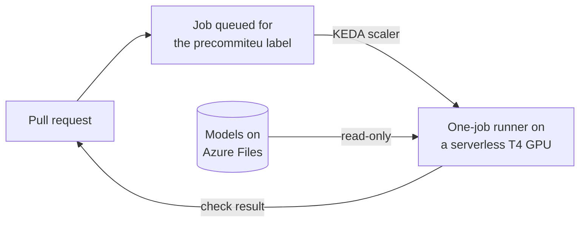

<p align="center">
  <picture>
    <source media="(prefers-color-scheme: dark)" srcset="https://raw.githubusercontent.com/AlexandruGirlea/precommiteu/main/docs/assets/img/bat-hero-dark.png">
    
  </picture>
</p>

<h1 align="center">precommitEU ops</h1>

<p align="center">
  <strong>Scan every pull request with precommitEU on your own Azure GPU.
  Your code never goes to an LLM provider.</strong>
</p>

<p align="center">
  Add it from Terraform or Pulumi: a self-hosted GitHub Actions runner on a
  serverless T4 GPU in Azure Container Apps, with the models on Azure Files.
</p>

<p align="center">
  <a href="https://github.com/AlexandruGirlea/precommiteu-ops/releases/latest"></a>
  <a href="https://github.com/AlexandruGirlea/precommiteu-ops/actions/workflows/ci.yml"></a>
  <a href="LICENSE"></a>
</p>

<p align="center">
  <a href="https://github.com/AlexandruGirlea/precommiteu"><strong>precommitEU</strong></a>
  &nbsp;&middot;&nbsp;
  <a href="#terraform">Terraform</a>
  &nbsp;&middot;&nbsp;
  <a href="#pulumi">Pulumi</a>
  &nbsp;&middot;&nbsp;
  <a href="https://huggingface.co/AlexandruGirlea/precommiteu-models">Model bundle</a>
  &nbsp;&middot;&nbsp;
  <a href="https://precommit.eu">precommit.eu</a>
</p>



## Air-gapped from LLM providers

precommitEU brings its own models and runs them on a GPU inside your Azure
subscription. Your code and the findings never go to OpenAI, Anthropic or any
other LLM provider, and there's no LLM API key to pay for or leak.

Besides GitHub, where your code already lives and where the scan results show
up, the only downloads are container images from GitHub's registry and, once
per version, the model weights from Hugging Face.

## Pin a version and it stays the same

Hosted models change under you. Providers update and retire them, and the same
pull request can get a different answer next month. Here each release pins the
scanner, the runner image and the model weights, so a version scans the same
way today and a year from now. We keep improving precommitEU, and you decide
when to move to a new release.

## What it creates

In an existing resource group:
- a Container Apps environment with a serverless GPU workload profile
  (`Consumption-GPU-NC8as-T4`: 8 vCPU, 56 GiB RAM, one 16 GB NVIDIA T4)
- a premium Azure Files share with the models, read-only at `/models` in runners
- `precommiteu-models`, a manual job that downloads the models into the share
- per repository, an event-driven job that starts a one-job runner when a
  workflow job asks for the `precommiteu` label

Idle, nothing runs: you pay only for the share.

Use a region with Container Apps serverless T4 GPUs, such as `swedencentral`,
`francecentral` or `westeurope`. If Azure refuses the GPU profile, request
"Managed Environment Consumption T4 Gpus" quota in a support request.

## Cost and speed

About **$25–46 a month for 100 pull request scans** of about 10 minutes each,
at Azure list prices in Sweden Central (November 2026):

| Item | Price |
|---|---|
| T4 GPU while a scan runs | $0.34 an hour, billed by the second |
| 8 vCPU and 56 GiB while a scan runs | up to $1.30 an hour more, if Azure bills them on top of the GPU |
| Models share (100 GB premium minimum) | $19 a month |
| One PR scan, about 10 minutes | $0.06–0.27 |

Startup takes most of those 10 minutes: a new runner needs about 2 minutes to
pick up the job and 4 more to load the models from the share. On the T4 the
first file then takes about 2 minutes and the rest 3 to 48 seconds each, so the
five-file `risky_code` fixture scans in about 4 minutes.

## How we tested 0.2.0

We deployed both the Terraform module and the Pulumi component into fresh
resource groups on Azure, and re-running `terraform plan` and `pulumi preview`
showed no changes. Then we built the runner image from this release's
Dockerfile and opened a real pull request against the Terraform deployment,
adding the five files of precommitEU's `risky_code` test fixture:

| Step | Time |
|---|---|
| Job queued until a runner started | 18 s |
| Runner up and registered with GitHub | 2 min |
| Models loaded | 4 min |
| Five files scanned, four GDPR issues found | 4 min |

The scan reported four GDPR findings and the check failed, as it should. On a
CPU-only runner the same scan ran out of time on four of the five files, which
is why 0.2.0 moves to a GPU.

## GitHub token

Create a fine-grained personal access token with `github_owner` as the
resource owner and access to only the repositories you scan:

| Repository permission | Access | Used by |
|---|---|---|
| Actions | Read-only | the scaler, to see queued jobs |
| Administration | Read and write | the runner, to register itself |
| Metadata | Read-only | required |

## Terraform

```hcl
module "precommiteu" {
  source              = "git::https://github.com/AlexandruGirlea/precommiteu-ops.git//terraform?ref=v0.2.0"
  resource_group_name = "ci"
  location            = "swedencentral"
  github_owner        = "my-org"
  github_repos        = ["api", "web"]
  github_pat          = var.github_pat
}
```

Optional input: `regulations` (`["gdpr"]`). The module uses the `azurerm` and
`azapi` providers: `azurerm` can't create serverless GPU profiles yet.

## Pulumi

Works from any Pulumi language, with the same inputs:

```bash
pulumi package add github.com/AlexandruGirlea/precommiteu-ops.git/pulumi@v0.2.0
```

```python
import pulumi
import pulumi_precommiteu as precommiteu

runner = precommiteu.Runner(
    "precommiteu",
    resource_group_name="ci",
    location="swedencentral",
    github_owner="my-org",
    github_repos=["api", "web"],
    github_pat=pulumi.Config().require_secret("githubPat"),
)
pulumi.export("download_job_name", runner.download_job_name)
```

## Download the models

Run the `download_job_name` job after the first deploy and each version change:

```bash
az containerapp job start --name precommiteu-models --resource-group ci
```

## Workflow

```yaml
on: pull_request
permissions:
  contents: read
jobs:
  precommiteu:
    runs-on: [self-hosted, precommiteu]
    steps:
      - uses: actions/checkout@v7
        with:
          fetch-depth: 0
      - uses: AlexandruGirlea/precommiteu@v0.3.1
```

If you changed `regulations`, set the action's `regulations` input to the same
packs, comma-separated.

## Versioning

Each release pins one scanner version, one runner image and one model revision:
see [CHANGELOG](CHANGELOG.md).

## Updating

Bump the `ref` or the `@` tag to the new release and apply, run the download
job again, and set the action tag in your workflow to its scanner version.

## Security

Use it for private repositories only: on a public repository, pull requests
from forks would run on your runner. The PAT ends up in your Terraform or
Pulumi state, so protect the state.

[Changelog](CHANGELOG.md) · [Contributing](CONTRIBUTING.md) · [Security policy](SECURITY.md)
